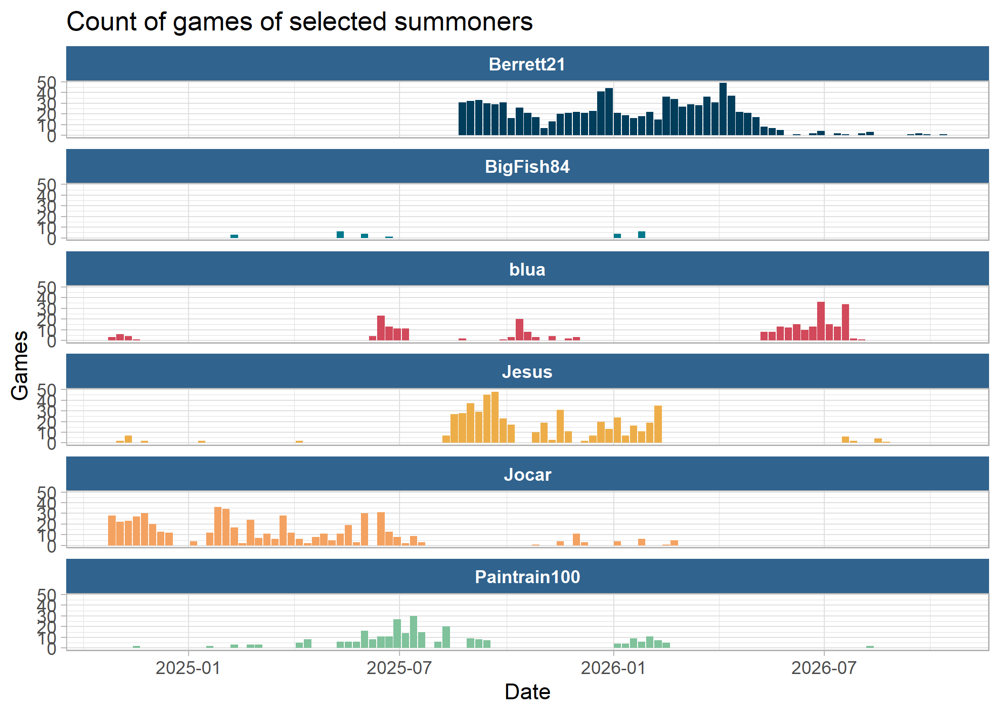
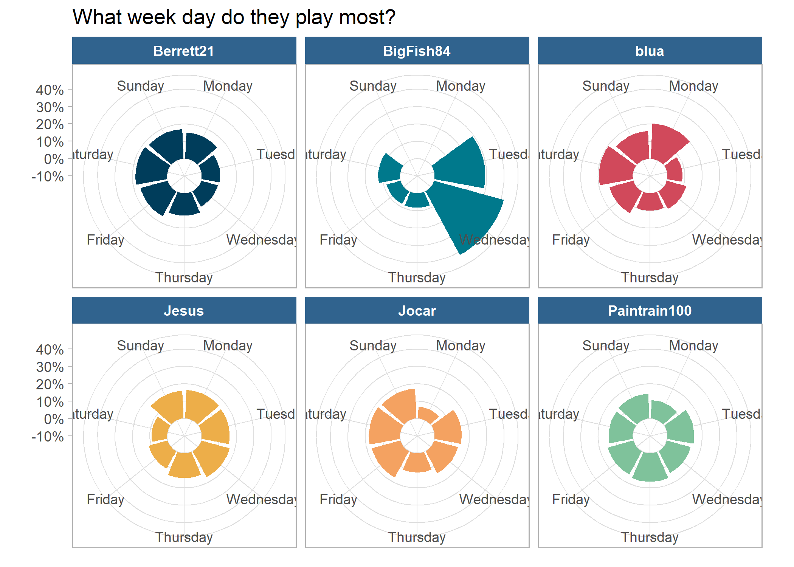
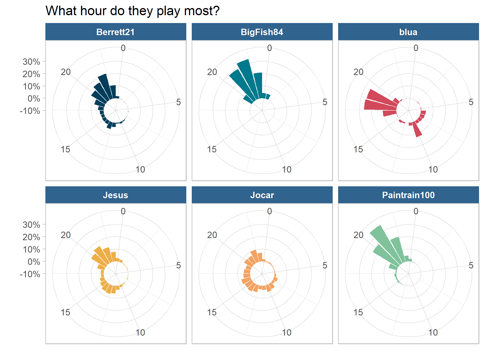
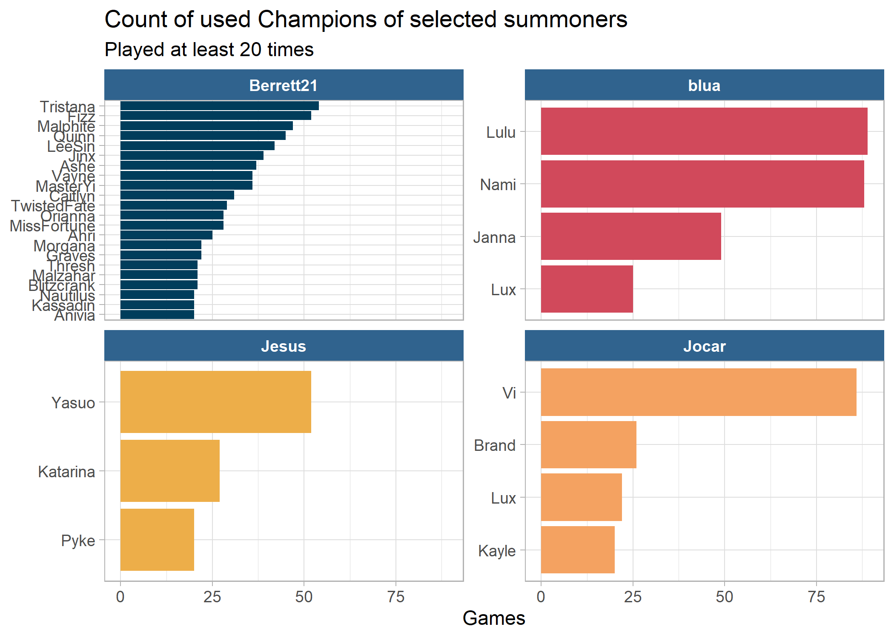
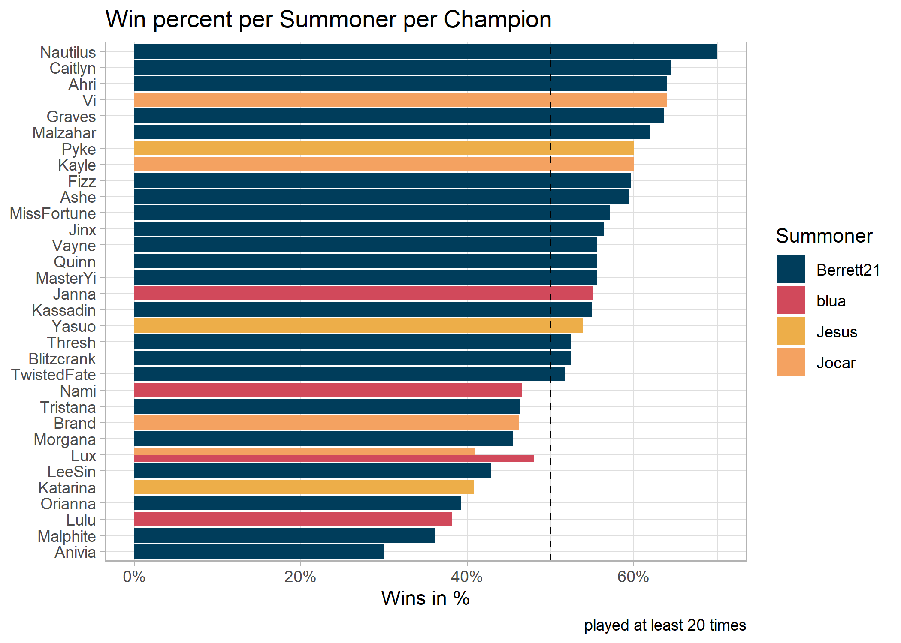
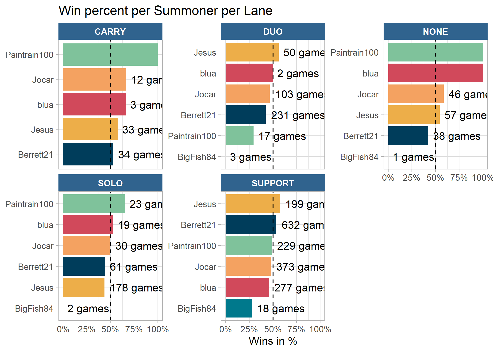
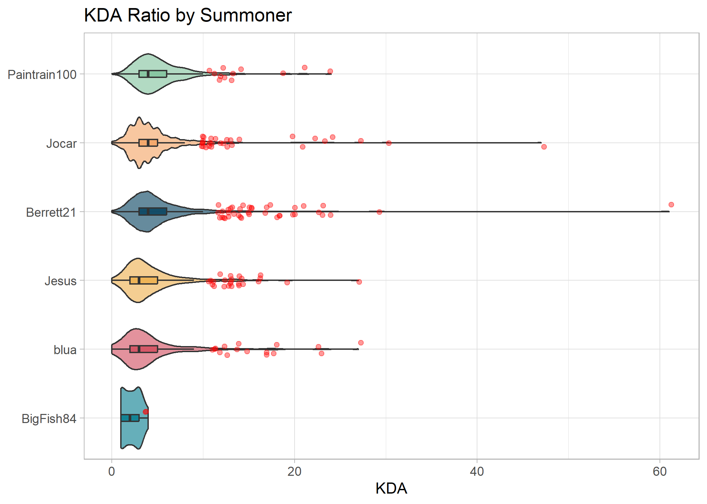
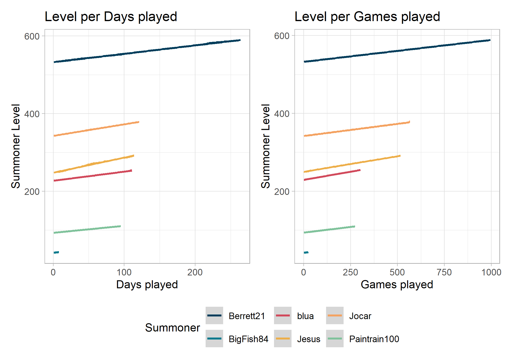

<!-- README.md is generated from README.Rmd. Please edit that file -->

# LOL Exploration

<!-- badges: start -->

<!-- badges: end -->

Statistics of a small group of League of Legends players, built from the
Riot match-v5 API (all queues). Games from 2024-10-31 to 2026-10-18:
2592 matches, 2678 player-games.

*This project is not endorsed by Riot Games and does not reflect the
views or opinions of Riot Games or anyone officially involved in
producing or managing Riot Games properties. Riot Games and all
associated properties are trademarks or registered trademarks of Riot
Games, Inc.*

<!-- --><!-- --><!-- --><!-- --><!-- --><!-- --><!-- -->
<table>

<caption>

Last 5 games per Summoner
</caption>

<thead>

<tr>

<th style="text-align:left;">

mode
</th>

<th style="text-align:left;">

time
</th>

<th style="text-align:left;">

champion
</th>

<th style="text-align:left;">

win
</th>

<th style="text-align:right;">

kills
</th>

<th style="text-align:right;">

assists
</th>

<th style="text-align:right;">

deaths
</th>

<th style="text-align:right;">

kda
</th>

</tr>

</thead>

<tbody>

<tr grouplength="5">

<td colspan="8" style="border-bottom: 1px solid;">

<strong>Berrett21</strong>
</td>

</tr>

<tr>

<td style="text-align:left;padding-left: 2em;" indentlevel="1">

ARAM
</td>

<td style="text-align:left;">

2026-10-16 21:50:43
</td>

<td style="text-align:left;">

Anivia
</td>

<td style="text-align:left;">

FALSE
</td>

<td style="text-align:right;">

6
</td>

<td style="text-align:right;">

16
</td>

<td style="text-align:right;">

9
</td>

<td style="text-align:right;">

2.4
</td>

</tr>

<tr>

<td style="text-align:left;padding-left: 2em;" indentlevel="1">

ARAM
</td>

<td style="text-align:left;">

2026-10-02 19:43:39
</td>

<td style="text-align:left;">

Leblanc
</td>

<td style="text-align:left;">

FALSE
</td>

<td style="text-align:right;">

15
</td>

<td style="text-align:right;">

17
</td>

<td style="text-align:right;">

11
</td>

<td style="text-align:right;">

2.9
</td>

</tr>

<tr>

<td style="text-align:left;padding-left: 2em;" indentlevel="1">

ARAM
</td>

<td style="text-align:left;">

2026-09-26 22:08:20
</td>

<td style="text-align:left;">

Fizz
</td>

<td style="text-align:left;">

TRUE
</td>

<td style="text-align:right;">

22
</td>

<td style="text-align:right;">

15
</td>

<td style="text-align:right;">

9
</td>

<td style="text-align:right;">

4.1
</td>

</tr>

<tr>

<td style="text-align:left;padding-left: 2em;" indentlevel="1">

ARAM
</td>

<td style="text-align:left;">

2026-09-26 21:48:53
</td>

<td style="text-align:left;">

Jinx
</td>

<td style="text-align:left;">

FALSE
</td>

<td style="text-align:right;">

11
</td>

<td style="text-align:right;">

18
</td>

<td style="text-align:right;">

7
</td>

<td style="text-align:right;">

4.1
</td>

</tr>

<tr>

<td style="text-align:left;padding-left: 2em;" indentlevel="1">

ARAM
</td>

<td style="text-align:left;">

2026-09-18 20:18:54
</td>

<td style="text-align:left;">

MissFortune
</td>

<td style="text-align:left;">

TRUE
</td>

<td style="text-align:right;">

19
</td>

<td style="text-align:right;">

36
</td>

<td style="text-align:right;">

7
</td>

<td style="text-align:right;">

7.9
</td>

</tr>

<tr grouplength="5">

<td colspan="8" style="border-bottom: 1px solid;">

<strong>BigFish84</strong>
</td>

</tr>

<tr>

<td style="text-align:left;padding-left: 2em;" indentlevel="1">

ARAM
</td>

<td style="text-align:left;">

2026-01-28 23:33:03
</td>

<td style="text-align:left;">

Lulu
</td>

<td style="text-align:left;">

FALSE
</td>

<td style="text-align:right;">

5
</td>

<td style="text-align:right;">

10
</td>

<td style="text-align:right;">

7
</td>

<td style="text-align:right;">

2.1
</td>

</tr>

<tr>

<td style="text-align:left;padding-left: 2em;" indentlevel="1">

ARAM
</td>

<td style="text-align:left;">

2026-01-28 23:14:07
</td>

<td style="text-align:left;">

MasterYi
</td>

<td style="text-align:left;">

FALSE
</td>

<td style="text-align:right;">

1
</td>

<td style="text-align:right;">

5
</td>

<td style="text-align:right;">

13
</td>

<td style="text-align:right;">

0.5
</td>

</tr>

<tr>

<td style="text-align:left;padding-left: 2em;" indentlevel="1">

ARAM
</td>

<td style="text-align:left;">

2026-01-28 22:53:44
</td>

<td style="text-align:left;">

MasterYi
</td>

<td style="text-align:left;">

FALSE
</td>

<td style="text-align:right;">

13
</td>

<td style="text-align:right;">

12
</td>

<td style="text-align:right;">

12
</td>

<td style="text-align:right;">

2.1
</td>

</tr>

<tr>

<td style="text-align:left;padding-left: 2em;" indentlevel="1">

ARAM
</td>

<td style="text-align:left;">

2026-01-28 22:24:02
</td>

<td style="text-align:left;">

Renekton
</td>

<td style="text-align:left;">

FALSE
</td>

<td style="text-align:right;">

11
</td>

<td style="text-align:right;">

18
</td>

<td style="text-align:right;">

18
</td>

<td style="text-align:right;">

1.6
</td>

</tr>

<tr>

<td style="text-align:left;padding-left: 2em;" indentlevel="1">

ARAM
</td>

<td style="text-align:left;">

2026-01-28 22:03:50
</td>

<td style="text-align:left;">

Yone
</td>

<td style="text-align:left;">

FALSE
</td>

<td style="text-align:right;">

4
</td>

<td style="text-align:right;">

4
</td>

<td style="text-align:right;">

11
</td>

<td style="text-align:right;">

0.7
</td>

</tr>

<tr grouplength="5">

<td colspan="8" style="border-bottom: 1px solid;">

<strong>blua</strong>
</td>

</tr>

<tr>

<td style="text-align:left;padding-left: 2em;" indentlevel="1">

ARAM
</td>

<td style="text-align:left;">

2026-08-27 19:43:33
</td>

<td style="text-align:left;">

Vex
</td>

<td style="text-align:left;">

TRUE
</td>

<td style="text-align:right;">

32
</td>

<td style="text-align:right;">

38
</td>

<td style="text-align:right;">

11
</td>

<td style="text-align:right;">

6.4
</td>

</tr>

<tr>

<td style="text-align:left;padding-left: 2em;" indentlevel="1">

CLASSIC
</td>

<td style="text-align:left;">

2026-08-16 23:26:04
</td>

<td style="text-align:left;">

Brand
</td>

<td style="text-align:left;">

TRUE
</td>

<td style="text-align:right;">

4
</td>

<td style="text-align:right;">

15
</td>

<td style="text-align:right;">

6
</td>

<td style="text-align:right;">

3.2
</td>

</tr>

<tr>

<td style="text-align:left;padding-left: 2em;" indentlevel="1">

CLASSIC
</td>

<td style="text-align:left;">

2026-08-16 22:54:38
</td>

<td style="text-align:left;">

Pyke
</td>

<td style="text-align:left;">

FALSE
</td>

<td style="text-align:right;">

2
</td>

<td style="text-align:right;">

1
</td>

<td style="text-align:right;">

1
</td>

<td style="text-align:right;">

3.0
</td>

</tr>

<tr>

<td style="text-align:left;padding-left: 2em;" indentlevel="1">

CLASSIC
</td>

<td style="text-align:left;">

2026-08-16 22:05:56
</td>

<td style="text-align:left;">

Senna
</td>

<td style="text-align:left;">

FALSE
</td>

<td style="text-align:right;">

8
</td>

<td style="text-align:right;">

30
</td>

<td style="text-align:right;">

5
</td>

<td style="text-align:right;">

7.6
</td>

</tr>

<tr>

<td style="text-align:left;padding-left: 2em;" indentlevel="1">

CLASSIC
</td>

<td style="text-align:left;">

2026-08-16 21:29:21
</td>

<td style="text-align:left;">

Zyra
</td>

<td style="text-align:left;">

FALSE
</td>

<td style="text-align:right;">

3
</td>

<td style="text-align:right;">

4
</td>

<td style="text-align:right;">

3
</td>

<td style="text-align:right;">

2.3
</td>

</tr>

<tr grouplength="5">

<td colspan="8" style="border-bottom: 1px solid;">

<strong>Jesus</strong>
</td>

</tr>

<tr>

<td style="text-align:left;padding-left: 2em;" indentlevel="1">

ARAM
</td>

<td style="text-align:left;">

2026-10-18 16:48:29
</td>

<td style="text-align:left;">

Warwick
</td>

<td style="text-align:left;">

TRUE
</td>

<td style="text-align:right;">

6
</td>

<td style="text-align:right;">

3
</td>

<td style="text-align:right;">

2
</td>

<td style="text-align:right;">

4.5
</td>

</tr>

<tr>

<td style="text-align:left;padding-left: 2em;" indentlevel="1">

ARAM
</td>

<td style="text-align:left;">

2026-02-27 18:27:24
</td>

<td style="text-align:left;">

Seraphine
</td>

<td style="text-align:left;">

TRUE
</td>

<td style="text-align:right;">

6
</td>

<td style="text-align:right;">

36
</td>

<td style="text-align:right;">

13
</td>

<td style="text-align:right;">

3.2
</td>

</tr>

<tr>

<td style="text-align:left;padding-left: 2em;" indentlevel="1">

ARAM
</td>

<td style="text-align:left;">

2026-02-27 16:47:08
</td>

<td style="text-align:left;">

Warwick
</td>

<td style="text-align:left;">

FALSE
</td>

<td style="text-align:right;">

4
</td>

<td style="text-align:right;">

6
</td>

<td style="text-align:right;">

13
</td>

<td style="text-align:right;">

0.8
</td>

</tr>

<tr>

<td style="text-align:left;padding-left: 2em;" indentlevel="1">

ARAM
</td>

<td style="text-align:left;">

2026-02-27 16:15:11
</td>

<td style="text-align:left;">

Lux
</td>

<td style="text-align:left;">

TRUE
</td>

<td style="text-align:right;">

6
</td>

<td style="text-align:right;">

55
</td>

<td style="text-align:right;">

7
</td>

<td style="text-align:right;">

8.7
</td>

</tr>

<tr>

<td style="text-align:left;padding-left: 2em;" indentlevel="1">

ARAM
</td>

<td style="text-align:left;">

2026-02-25 02:14:37
</td>

<td style="text-align:left;">

Brand
</td>

<td style="text-align:left;">

TRUE
</td>

<td style="text-align:right;">

5
</td>

<td style="text-align:right;">

21
</td>

<td style="text-align:right;">

10
</td>

<td style="text-align:right;">

2.6
</td>

</tr>

<tr grouplength="5">

<td colspan="8" style="border-bottom: 1px solid;">

<strong>Jocar</strong>
</td>

</tr>

<tr>

<td style="text-align:left;padding-left: 2em;" indentlevel="1">

ARAM
</td>

<td style="text-align:left;">

2026-08-13 18:18:27
</td>

<td style="text-align:left;">

Varus
</td>

<td style="text-align:left;">

FALSE
</td>

<td style="text-align:right;">

6
</td>

<td style="text-align:right;">

35
</td>

<td style="text-align:right;">

8
</td>

<td style="text-align:right;">

5.1
</td>

</tr>

<tr>

<td style="text-align:left;padding-left: 2em;" indentlevel="1">

ARAM
</td>

<td style="text-align:left;">

2026-08-13 17:57:43
</td>

<td style="text-align:left;">

Nidalee
</td>

<td style="text-align:left;">

TRUE
</td>

<td style="text-align:right;">

13
</td>

<td style="text-align:right;">

22
</td>

<td style="text-align:right;">

5
</td>

<td style="text-align:right;">

7.0
</td>

</tr>

<tr>

<td style="text-align:left;padding-left: 2em;" indentlevel="1">

ARAM
</td>

<td style="text-align:left;">

2026-02-21 00:41:43
</td>

<td style="text-align:left;">

JarvanIV
</td>

<td style="text-align:left;">

TRUE
</td>

<td style="text-align:right;">

3
</td>

<td style="text-align:right;">

31
</td>

<td style="text-align:right;">

15
</td>

<td style="text-align:right;">

2.3
</td>

</tr>

<tr>

<td style="text-align:left;padding-left: 2em;" indentlevel="1">

ARAM
</td>

<td style="text-align:left;">

2026-02-21 00:00:19
</td>

<td style="text-align:left;">

Alistar
</td>

<td style="text-align:left;">

TRUE
</td>

<td style="text-align:right;">

5
</td>

<td style="text-align:right;">

35
</td>

<td style="text-align:right;">

8
</td>

<td style="text-align:right;">

5.0
</td>

</tr>

<tr>

<td style="text-align:left;padding-left: 2em;" indentlevel="1">

ARAM
</td>

<td style="text-align:left;">

2026-02-19 21:56:08
</td>

<td style="text-align:left;">

Nidalee
</td>

<td style="text-align:left;">

FALSE
</td>

<td style="text-align:right;">

14
</td>

<td style="text-align:right;">

12
</td>

<td style="text-align:right;">

9
</td>

<td style="text-align:right;">

2.9
</td>

</tr>

<tr grouplength="5">

<td colspan="8" style="border-bottom: 1px solid;">

<strong>Paintrain100</strong>
</td>

</tr>

<tr>

<td style="text-align:left;padding-left: 2em;" indentlevel="1">

CLASSIC
</td>

<td style="text-align:left;">

2026-08-02 19:23:58
</td>

<td style="text-align:left;">

Nami
</td>

<td style="text-align:left;">

FALSE
</td>

<td style="text-align:right;">

0
</td>

<td style="text-align:right;">

5
</td>

<td style="text-align:right;">

2
</td>

<td style="text-align:right;">

2.5
</td>

</tr>

<tr>

<td style="text-align:left;padding-left: 2em;" indentlevel="1">

CLASSIC
</td>

<td style="text-align:left;">

2026-08-01 20:00:29
</td>

<td style="text-align:left;">

Janna
</td>

<td style="text-align:left;">

TRUE
</td>

<td style="text-align:right;">

1
</td>

<td style="text-align:right;">

21
</td>

<td style="text-align:right;">

7
</td>

<td style="text-align:right;">

3.1
</td>

</tr>

<tr>

<td style="text-align:left;padding-left: 2em;" indentlevel="1">

CLASSIC
</td>

<td style="text-align:left;">

2026-07-26 10:28:33
</td>

<td style="text-align:left;">

Lulu
</td>

<td style="text-align:left;">

FALSE
</td>

<td style="text-align:right;">

5
</td>

<td style="text-align:right;">

7
</td>

<td style="text-align:right;">

8
</td>

<td style="text-align:right;">

1.5
</td>

</tr>

<tr>

<td style="text-align:left;padding-left: 2em;" indentlevel="1">

CLASSIC
</td>

<td style="text-align:left;">

2026-07-25 19:10:13
</td>

<td style="text-align:left;">

Nami
</td>

<td style="text-align:left;">

FALSE
</td>

<td style="text-align:right;">

0
</td>

<td style="text-align:right;">

23
</td>

<td style="text-align:right;">

3
</td>

<td style="text-align:right;">

7.7
</td>

</tr>

<tr>

<td style="text-align:left;padding-left: 2em;" indentlevel="1">

CLASSIC
</td>

<td style="text-align:left;">

2026-07-25 18:44:18
</td>

<td style="text-align:left;">

Janna
</td>

<td style="text-align:left;">

TRUE
</td>

<td style="text-align:right;">

2
</td>

<td style="text-align:right;">

7
</td>

<td style="text-align:right;">

2
</td>

<td style="text-align:right;">

4.5
</td>

</tr>

</tbody>

</table>

<!-- -->

## Time played

| description | Berrett21 | BigFish84 | Jesus | Jocar | Paintrain100 | blua |
|:---|---:|---:|---:|---:|---:|---:|
| 5v5 ARAM games | 8d 19H 30M 29S | 7H 0M 31S | 1d 7H 25M 29S | 6d 1H 28M 3S | 3d 14H 11M 2S | 0S |
| 5v5 Draft Pick games | 0S | 0S | 4H 50M 7S | 52M 36S | 0S | 1H 57M 21S |
| 5v5 Ranked Flex games | 0S | 0S | 0S | 0S | 0S | 1H 0M 34S |
| 5v5 Ranked Solo games | 0S | 0S | 6d 0H 42M 19S | 3H 52M 1S | 0S | 6d 2H 11M 33S |
| ARURF games | 4d 21H 30M 11S | 9M 48S | 2d 0H 57M 35S | 4H 23M 54S | 9M 48S | 0S |
| Normal (Quickplay) | 0S | 0S | 0S | 15M 38S | 0S | 0S |
| Swiftplay Games | 0S | 0S | 25M 40S | 1d 9H 13M 10S | 1H 47M 7S | 33M 35S |
| Total | 13d 17H 0M 40S | 7H 10M 19S | 9d 14H 21M 10S | 7d 20H 5M 22S | 3d 16H 7M 57S | 6d 5H 43M 3S |

Time play per queue ID
